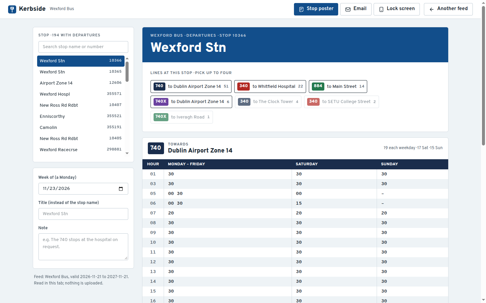
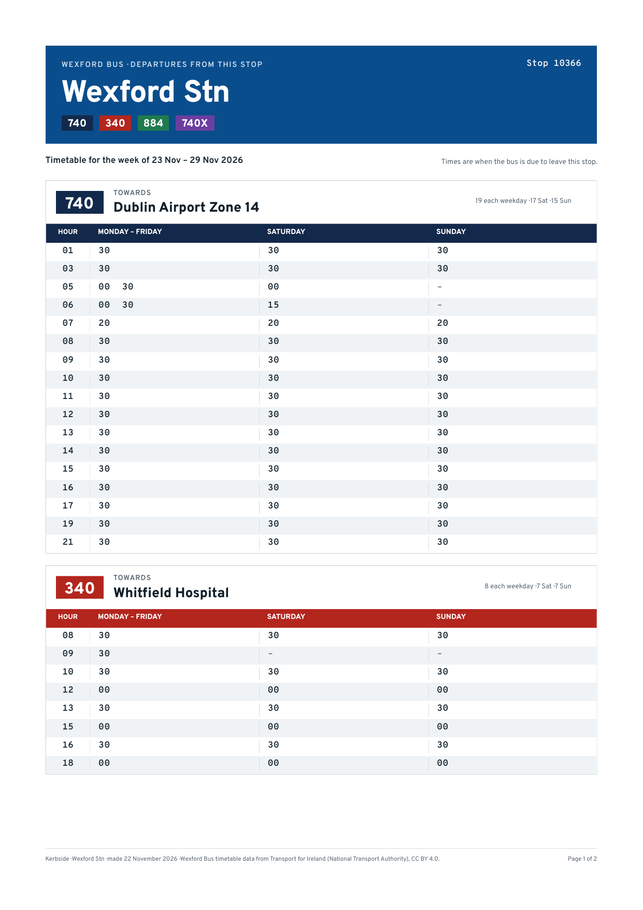
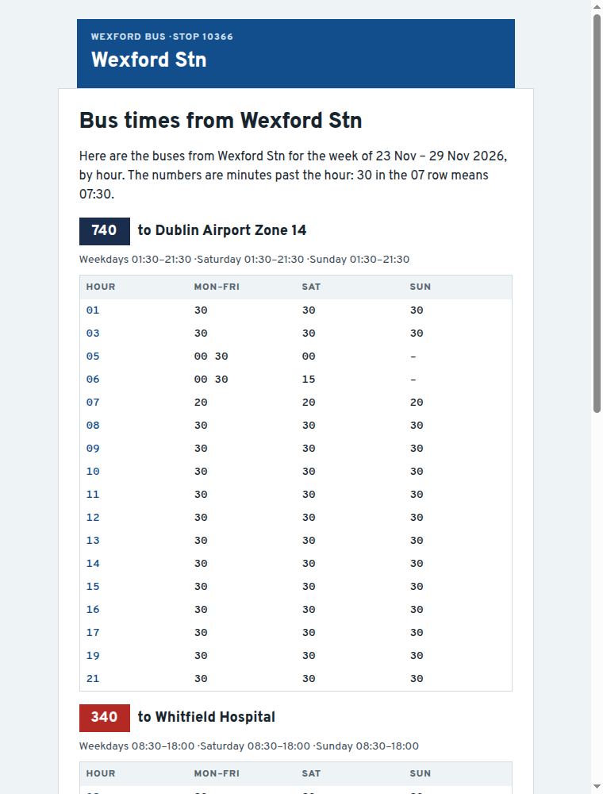
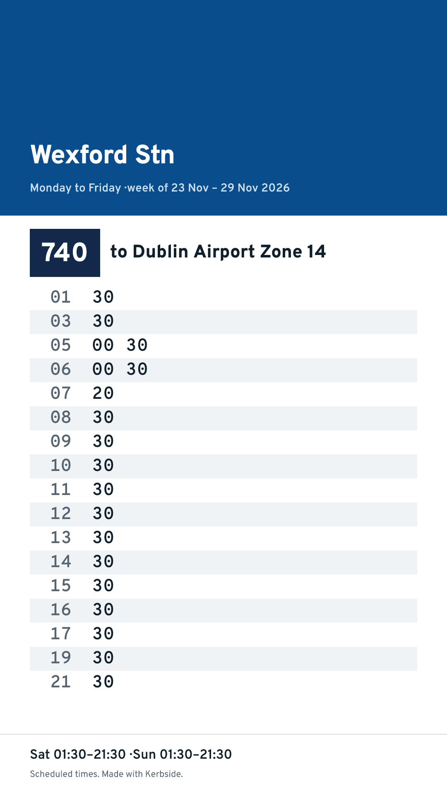

# Kerbside

**The timetable your stop used to have on paper.** Drop in any transit operator's GTFS feed and pick a stop.
Kerbside reads which services run on each day of the week you choose and makes:

- a stop poster (PDF, A4): each line at the stop with its departures by hour for Monday to Friday, Saturday and
  Sunday, footnotes worked out ("a: Fridays only")
- an email of the times, for someone who won't use the app: every bus by hour, first and last bus per day
- a lock-screen image (PNG, 1080 × 1920) of one line's weekday times, readable with no signal

Built with [Hyper Elements](https://github.com/hyper-elements/hyper-elements) for the Hyper Elements Template Challenge.

**Live:** https://kerbside.rohitkashyapmrt.workers.dev



## Why this exists

Every operator publishes its timetable as GTFS so journey-planner apps can read it. Fewer still print one for each
stop. On r/WMATA, after the PDF bus timetables went ([Jan 2026](https://www.reddit.com/r/WMATA/comments/1q6f0xq/)):
"a downloadable PDF of the FULL route's timetable … for BOTH directions, weekday AND weekend was the easiest to read …
Also, when my phone dies, now what?" On r/MelbourneTrains, "Want to print a bus stop timetable for home"
([Jul 2026](https://www.reddit.com/r/MelbourneTrains/comments/1v64io4/)): "I was looking for something like this too
for my grandparents, couldn't find anything and ended up having to make it manually in excel!!" And on r/transit
([1pt793t](https://www.reddit.com/r/transit/comments/1pt793t/)): "Is there anywhere that presents GTFS data in an easy
to read format for people unfamiliar with using raw data?"

**A real example.** Wexford Bus's GTFS feed, as Transport for Ireland publishes it (CC BY 4.0). The busiest stop,
Wexford Stn (stop 10366), the week of 23 November 2026:

| Line | Towards | Weekday | Saturday | Sunday |
|---|---|---|---|---|
| 740 | Dublin Airport Zone 14 | 19 | 17 | 15 |
| 340 | Whitfield Hospital | 8 | 7 | 7 |
| 884 | Main Street | 6 | 4 | 4 |
| 740X | Dublin Airport Zone 14 | 3 | 2 | 1 |

| Stop poster, page 1 | Email | Lock screen |
|---|---|---|
|  |  |  |

The landing page (7 sections with an FAQ): [media/landing.png](media/landing.png). On a phone:
[media/mobile.png](media/mobile.png) and [media/mobile-stop.png](media/mobile-stop.png). The sample poster:
[public/landing/timetable.pdf](public/landing/timetable.pdf).

## How it works

| Step | What happens |
|---|---|
| **Open the feed** | The GTFS zip is opened in the browser with fflate; only the files a timetable needs are unpacked (`shapes.txt` can be most of a feed). `templates/_shared/gtfs.ts` parses the CSV (RFC 4180: quotes, commas in quotes, CRLF, BOM). |
| **Pick the stop** | Stops with departures, busiest first (a parent station includes its platforms); search by name or stop number. |
| **Pick the week** | For each day of the week from the Monday you choose, a service runs if `calendar.txt` says so for that weekday and date range, unless `calendar_dates.txt` adds or removes that date. |
| **Lines** | A line is a route plus its headsign. The last stop of each trip is left out (nobody boards there), and so are no-pickup stops. Up to four lines, the busiest first. |
| **Lay out** | Departures by hour; a weekday departure that doesn't run every weekday gets a letter with its meaning ("a: Fridays only", "b: not on Mondays"); times past 24:00 stay at the end of their service day. |

## How Hyper Elements is used

The three outputs are **Hyper Elements templates** in `templates/`. The app renders them in the browser
(`src/lib/render-route.ts`, so the site runs on Cloudflare as static files), and the CLI renders the same files.

- **Typed fields with rules:** every minute must look like `05` or `35a` (a footnote letter), hours are 0–23, route
  colours are `#RRGGBB`, one to four lines, up to 24 hours each. Values outside the rules stop the render with the
  field and the reason.
- **`<Document>` + `renderPdf()`** for the A4 stop poster in Overpass (a typeface after the US highway signs) and
  Overpass Mono: the stop's name on a signage-blue band with its lines' route boxes, then a striped table per line,
  coloured with the route's colour from the feed. Pages are planned from the row counts, because a Document page doesn't
  flow by itself.
- **`<Email>`** with `Table`, `TableRow` and `TableCell` for the times, lint (`lang`, `contrast`, `link-text`), the
  email client checks and preview text required (the weekday first and last buses).
- **`<Canvas>` + `renderImage()`** for the 1080 × 1920 lock screen, with `image/overflow`, `image/glyph` and
  `image/fit` required: the top third stays empty for the phone's clock, and the row size is worked out from the number
  of hours so the day always fits.
- **Values files + CLI:** `npm run sheets` turns `docs/sample.json` into values files with `hyper-elements design
  new`, then renders all three with `hyper-elements render`.

## Run it

Needs Node 22.6+.

```bash
npm install
npm run dev            # http://localhost:3000 (landing) and /stop (the dashboard)
```

```bash
npm test               # CSV, service days and exceptions, footnotes, after midnight, the real sample (5 tests)
npm run check          # check the three templates with their example
npm run sheets         # docs/sample.json → renders/docs/ (poster PDF, email, lock screen PNG)
npm run sample         # rebuild the sample (pass a fresh GTFS_Wexford_Bus.zip to refresh the feed)
npm run preview:email  # the email as each email client draws it
npm run build && npx wrangler dev   # the static site, served the way Cloudflare does
```

## Project layout

```
templates/_shared/gtfs.ts     GTFS CSV, the feed, service days, a stop's lines and departures, the hour table
templates/_shared/doc.tsx     fields, the stop-panel look, the route box
templates/_shared/example.ts  the sample (generated by scripts/sample.ts)
templates/poster.tsx          <Document>: the stop poster
templates/note.tsx            <Email>: the timetable email
templates/phone.tsx           <Canvas>: the lock screen
src/lib/load.ts               opens a GTFS zip in the browser
src/lib/render-route.ts       renders the templates in the browser
src/components/Planner.tsx    the dashboard
src/app/page.tsx              the landing page
public/samples/wexford-bus.zip  the sample feed
tests/                        tests
```

## Sample data

`public/samples/wexford-bus.zip` is Wexford Bus's GTFS feed (`GTFS_Wexford_Bus.zip`) from
[Transport for Ireland's public transport data](https://www.transportforireland.ie/transitData/PT_Data.html),
downloaded on 22 November 2026: "licensed under CC BY 4.0 and attributed to the National Transport Authority". Changes:
`shapes.txt` and `translations.txt` were left out to keep it small; nothing else was changed. Kerbside is not affiliated
with Wexford Bus, Transport for Ireland or the National Transport Authority. The times are scheduled times, not live.

## License

MIT for the code. Fonts: Overpass and Overpass Mono, SIL Open Font License 1.1. Sample feed: CC BY 4.0 (see above).
